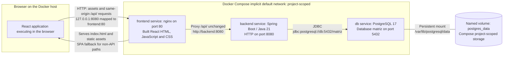

# Matriz — Arquitetura do MVP

## Current Docker Compose topology — Ficha 05

This diagram reflects `compose.yaml`, both Dockerfiles and `frontend/nginx.conf`. The existing P1 decisions and historical proposals below are preserved; their future-tense implementation statements do not describe the current deployment configuration.

- React runs in the browser, not as a Node server in the runtime container. The frontend build stage uses Node/Vite; nginx serves the resulting `dist` files from `/usr/share/nginx/html`.
- Only nginx is published to the host, at loopback `127.0.0.1:8080`. Backend and PostgreSQL have no published host ports; Compose service DNS resolves `backend` and `db` on the implicit default network. API responses return through nginx to the same browser origin.
- The backend runtime is a Java 21 JRE running `/app/matriz.jar` as the non-root `matriz` user. PostgreSQL data uses the named volume independently of container lifetime; its Docker name is normally prefixed by the Compose project name. The volume is storage, not a network service.
- This is the configured local HTTP topology, not HTTPS or a public deployment. Build tools are not runtime services. No credentials are represented, and this diagram does not imply new runtime validation.

## Current implementation boundaries and evidence — 2026-11-16

Java 21/Spring Boot **3.5.16** backend uses Spring Security sessions/CSRF and JDBC through domain controllers (`auth`, `projects`, `tasks`); Flyway applies V1/V2. React/react-dom **19.3.1**, Vite **8.3.8** build browser assets; PostgreSQL image is **17.11-bookworm**. The historical service-layer separation below is a design intention, not an implemented extra service/repository tier: current controllers contain business rules and JDBC. No refactor is implied by this description.

Compose defines DB `pg_isready`, backend curl `/api/health`, and frontend HTML healthchecks. Backend waits for healthy DB and frontend initially waits for healthy backend. Startup gating does not continuously stop nginx if backend later fails. Backend runs as non-root `matriz`; nginx runtime uses its conventional image privileges. Local loopback HTTP is not an approved public HTTPS topology.

Latest isolated post-fix verification: **244 passes (199 backend + 45 frontend)**, all passed, production build passed. Earlier full-regression baseline: **252 distinct tests (167 backend + 37 PostgreSQL + 5 browser E2E + 43 frontend)**; PostgreSQL/browser suites were not rerun after the later description/comment Unicode and raw-decimal fixes. No complete all-layer regression after those fixes is claimed; see [verification](verification.md). Existing isolated Compose persistence/recreation and healthy/unhealthy startup-gate records are in [Ficha 05 validation](ficha05-validation.md); these were not rerun after the validation fixes or in this audit. Remote Actions, final candidate secret review/clean checkout and human release acceptance remain open. Proposed release `0.1.0-rc.1` is not synchronized with manifest versions (`0.1.0-SNAPSHOT` backend; `0.0.0` frontend), nor approved/published.

## Historical P1 — approved domain decisions, pre-implementation descriptions

D2 e complemento aprovado definem **Java 21 LTS + Spring Boot 3.5.x** num backend **monólito modular**, **React 19.x** para interface e **PostgreSQL 17.x** para persistência. Verificar suporte e compatibilidade antes da implementação e fixar as versões exatas nessa fase futura; qualquer substituição requer aprovação humana. Suporte e compatibilidade não foram verificados nesta atualização documental. Trata-se de arquitetura aprovada para implementação futura, não software implementado.

Módulos conceptuais: identidade/sessões, projetos/participações, tarefas/atribuições, comentários/histórico e consultas/painel. Fluxo: React → API REST Spring Boot → serviços de negócio → persistência PostgreSQL. Controladores não substituem regras de negócio e autorização nos serviços. Fronteiras de módulos são proposta organizacional, não uma estrutura de código criada.

**D4:** sessão Spring Security com cookie HttpOnly e CSRF, substituindo JWT/Bearer. Bootstrap CSRF e convenções `JSESSIONID`/`X-CSRF-TOKEN` aprovados sob condição de coerência com D3/D4; validar CSRF em pedidos mutáveis, incluindo ciclo de autenticação; identidade/autor derivam da sessão. HttpOnly aplica-se ao cookie de sessão: React não precisa de ler esse cookie. Política aprovada: inatividade máxima 30 minutos; duração absoluta máxima 8 horas; SameSite=Lax; Secure em HTTPS; rotação no login e invalidação no logout; CSRF incluindo login/logout. Atividade não prolonga o limite absoluto. Frontend/API na mesma origem, HTTPS no ambiente publicado e proxy em desenvolvimento; não permitir origens arbitrárias com credenciais. Não há configuração executável nesta P1.

**D3/D6:** gestor e membro por projeto, participação direta. Equipas e team leaders do modelo anterior não condicionam elegibilidade. Matriz aprovada: gestor edita/elimina projeto, cria/edita/altera estado de qualquer tarefa, elimina tarefas e gere responsáveis; membro cria tarefas e só edita/altera estado das atribuídas a si; ambos consultam/comentam. 401 sem autenticação; 404 recurso inexistente/inacessível; 403 sem permissão sobre recurso acessível. Criador é associado automaticamente como gestor na transação de criação: projeto privado, sem outros membros.

**D5/D7/D10:** atribuição N:M com zero responsáveis permitidos. Eliminação definitiva e transacional de projeto/tarefa e dependentes, incluindo histórico. Alterações efetivas de estado, prioridade e responsáveis e respetivo histórico devem ser atómicas. Nenhum histórico para no-op, texto ou comentários. UTC e identidade autenticada nos registos.

**D9:** listas completas sem paginação no MVP; agregações consultam o universo autorizado, não uma fatia da listagem. Contagens por projeto aplicam prioridade mas não estado; total da lista aplica ambos; painel global abrange projetos acessíveis. Projetos: `id DESC`; tarefas: `createdAt DESC, id DESC`; comentários e histórico: data UTC `ASC, id ASC`; responsáveis elegíveis: nome sem distinguir maiúsculas/minúsculas `ASC, id ASC`. Pesquisa por substring literal no nome, com trim, sem distinguir maiúsculas/minúsculas (case-insensitive), mas distinguindo acentos (accent-sensitive). Valor omitido ou vazio após trim não aplica filtro; `%` e `_` são caracteres literais, não wildcards.

Descrições de projetos e tarefas: na criação, campo omitido ou `null` significa ausência; em PATCH, omitido mantém o valor e `null` remove-o. Texto é sujeito a trim e rejeitado se ficar vazio, respeitando os limites D8. A API devolve `null` quando a descrição está ausente.

Em CreateTask, membro pode omitir responsáveis ou enviar `[]`; uma lista não vazia devolve 403 sem criação parcial, incluindo tentativa de autoatribuição. Gestor pode indicar responsáveis elegíveis por participação direta no projeto.

Contrato canónico: `../openapi.yaml`; cópia `matriz-openapi.yaml` sincronizada. Plano e decisões completos em `implementation-plan.md`. P1 exclusivamente documental; P2 bloqueada até nova autorização.

## Contexto histórico — proposta da Ficha 02

O texto seguinte preserva alternativas e fundamentos. “Pendente”, “responsável único” e regras de âmbito anteriores não prevalecem sobre D1–D10.

## 1. Contexto
A Matriz é uma aplicação de gestão de projetos e tarefas para equipas. Esta proposta responde ao Exercício 1 da Ficha Prática 02 e deverá ser confrontada com `requirements.md`, `user-stories.md`, `constraints.md` e `AGENTS.md` da Aula 01 antes da aprovação final.

## 2. Alternativas consideradas

| Alternativa | Vantagens | Limitações para o MVP |
|---|---|---|
| Monólito tradicional | Implementação e deployment simples; baixo custo operacional | Maior risco de acoplamento e mistura de responsabilidades |
| Monólito modular | Um único deployment; módulos coesos; manutenção e testes facilitados | Exige disciplina na definição das fronteiras entre módulos |
| Microserviços | Escalabilidade e deployment independentes | Complexidade de comunicação, observabilidade, infraestrutura e testes distribuídos desproporcionada para o MVP |

## 3. Decisão
**Proposta: adotar um monólito modular para o backend do MVP (pendente de validação humana).**

### Justificação
A Matriz tem um âmbito inicial limitado e funcionalidades relacionadas entre si. O monólito modular permite entregar uma solução simples, com uma única aplicação backend, evitando a complexidade operacional de microserviços. Ao mesmo tempo, separa responsabilidades por domínio e reduz o risco de evolução desorganizada típico de um monólito sem fronteiras claras.

### Consequências e trade-offs
- **Positivas:** deployment simples, desenvolvimento e testes integrados, separação de responsabilidades e evolução incremental.
- **Negativas:** os módulos partilham o ciclo de deployment; a equipa terá de impedir dependências cruzadas indevidas.
- **Reavaliação:** considerar outra arquitetura apenas se surgirem requisitos demonstrados de escala, autonomia ou isolamento operacional.

## 4. Componentes e responsabilidades propostos

| Componente | Responsabilidade |
|---|---|
| Interface web | Apresentar projetos e tarefas e recolher ações dos utilizadores |
| API REST | Expor operações do MVP, validar pedidos e devolver respostas HTTP |
| Módulo Projetos | Gerir dados e regras de negócio de projetos |
| Módulo Tarefas | Gerir tarefas e a sua associação a projetos |
| Módulo Utilizadores | Gerir dados básicos de utilizadores necessários ao MVP, sujeito à confirmação dos requisitos |
| Persistência | Guardar e consultar entidades numa base de dados; tecnologia por decidir |

O backend deve manter fronteiras explícitas entre módulos, com regras de negócio separadas dos controladores HTTP e do acesso a dados.

## 5. Fluxo conceptual
Interface web → API REST → Módulos de negócio → Persistência → Base de dados.

## 6. Pressupostos e pontos por confirmar
- Confirmar as funcionalidades exatas de cada módulo face ao Specification Pack da Aula 01.
- Confirmar se existe gestão de equipas no âmbito do MVP e, nesse caso, acrescentar o respetivo módulo.
- Confirmar requisitos de autenticação, autorização, stack tecnológica e base de dados; **não estão decididos neste documento**.
- A modelação atual inclui comentários e histórico de tarefas como extensões propostas, documentadas em `database.md` e `matriz-openapi.yaml`; a sua inclusão no MVP depende de validação do cliente.
- Manter **um único responsável obrigatório** por tarefa. Não adotar a atribuição N:M do exemplo do professor.
- As associações entre equipas, projetos e membros estão representadas no modelo de dados, mas os fluxos de gestão dessas associações ainda carecem de definição.
- Nesta ficha **não será implementado código funcional**.

## 7. Estado
**Proposta inicial — decisão arquitetural acordada para discussão; validação documental pendente.**
