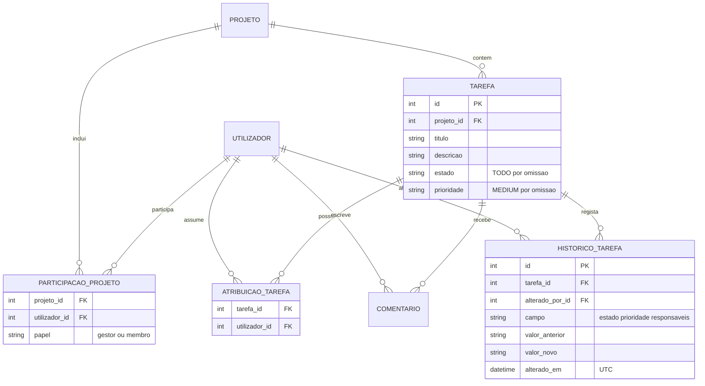
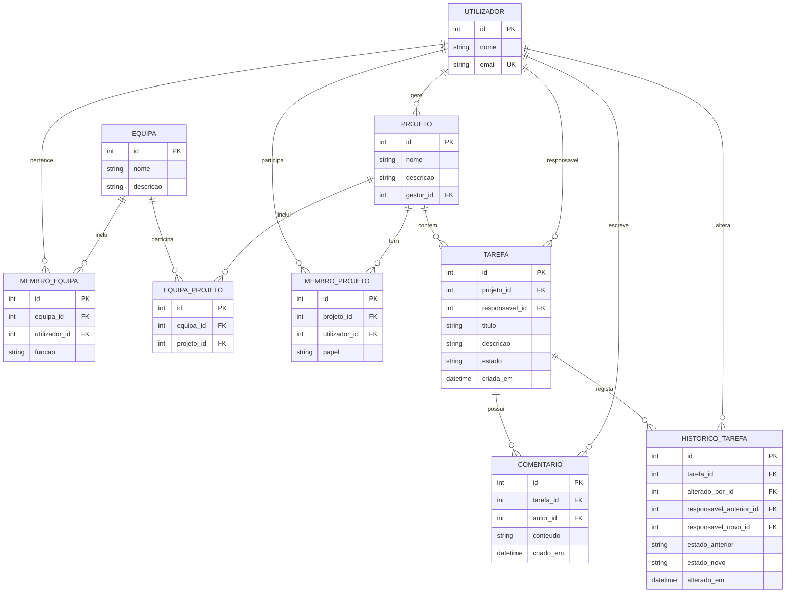

# Matriz — Modelo de Dados

## P1 — modelo lógico vigente (D3, D5–D10)

Modelo documental, sem SQL, migrations ou alterações de dados. O diagrama histórico da Ficha 02 abaixo não é o esquema alvo quando diverge desta secção.

- Participação direta única por `(projeto_id, utilizador_id)`; papel gestor/membro contextual ao projeto. Seed aprovado, não executado. Regra aprovada: na mesma transação da criação do projeto, associar a identidade autenticada como gestor; projeto inicialmente privado, sem outros membros. Falha na associação reverte a criação; seed não acrescenta membros automaticamente a cada projeto criado.
- Tarefa tem exatamente um projeto e zero ou mais responsáveis via atribuição única `(tarefa_id, utilizador_id)`. Remover o conceito de `responsavel_id NOT NULL` do modelo alvo. Todo responsável deve ser participante direto do projeto; equipas não são pré-condição.
- Projeto: nome 3–100, descrição opcional até 1000; tarefa: título 3–150, descrição opcional até 2000; comentário: conteúdo 1–2000. Trim antes de validar; texto fornecido vazio rejeitado. Estados TODO/IN_PROGRESS/DONE e prioridades LOW/MEDIUM/HIGH, criação TODO/MEDIUM.
- Comentário tem tarefa, autor da sessão e data. Histórico só de alterações efetivas de estado/prioridade/conjunto de responsáveis. Guardar anterior e novo (conjunto de IDs no caso de responsáveis), autor e instante UTC; sem eventos de criação/edição textual/comentário/no-op. Representação física destes valores permanece por implementar.
- Alteração e histórico na mesma transação. Eliminações definitivas/transacionais: projeto → participações e tarefas; tarefa → atribuições, comentários e histórico. Preservar utilizadores; não manter histórico órfão. Falha deve reverter a operação completa.
- Consultas e agregações respeitam D9, descrita em requirements.md. Índices e SQL serão trabalho futuro não autorizado nesta P1.
- Aplicar matriz D3 aprovada em implementation-plan.md: gestor gere projeto/responsáveis e qualquer tarefa; membro cria tarefas e só edita/altera estado das atribuídas a si; ambos consultam/comentam. Atribuição não concede poderes de eliminar/gerir responsáveis. Não reutilizar regras antigas team leader/developer.

### Complementos aprovados ao modelo e às consultas

Persistência alvo: PostgreSQL 17.x, integrada com Java 21 LTS/Spring Boot 3.5.x e interface React 19.x. Verificar suporte e compatibilidade antes da implementação e fixar as versões exatas nessa fase futura; qualquer substituição requer aprovação humana. Suporte e compatibilidade não foram verificados nesta atualização documental.

Descrições de projetos e tarefas: na criação, campo omitido ou `null` significa ausência; em PATCH, omitido mantém o valor e `null` remove-o. Texto é sujeito a trim e rejeitado se ficar vazio, respeitando os limites D8. A API devolve `null` quando a descrição está ausente. O modelo lógico admite nulidade nas descrições; não se executa qualquer alteração física nesta fase.

Listas completas sem paginação no MVP. Projetos: `id DESC`; tarefas: `createdAt DESC, id DESC`; comentários e histórico: data UTC `ASC, id ASC`; responsáveis elegíveis: nome sem distinguir maiúsculas/minúsculas `ASC, id ASC`. O instante de criação da tarefa (`createdAt`) e as datas UTC de comentários/histórico sustentam estas ordenações; não se escolhem índices ou SQL nesta P1. Pesquisa por substring literal no nome, com trim, sem distinguir maiúsculas/minúsculas (case-insensitive), mas distinguindo acentos (accent-sensitive). Valor omitido ou vazio após trim não aplica filtro; `%` e `_` são caracteres literais, não wildcards.

Em CreateTask, membro pode omitir responsáveis ou enviar `[]`; uma lista não vazia devolve 403 sem criação parcial, incluindo tentativa de autoatribuição. Gestor pode indicar responsáveis elegíveis por participação direta no projeto. Estas verificações respeitam D3 e não concedem gestão de responsáveis ao membro.

## Contexto histórico — Exercício 2 (Ficha 02)

Preservado para rastreabilidade, não modelo vigente: responsável singular, equipas e permissões abaixo foram substituídos ou não aprovados por D3/D5/D6.

## Diagrama Entidade-Relação

## Cardinalidades e regras de negócio

- Utilizadores e equipas: N:M, através de `MEMBRO_EQUIPA`.
- Equipas e projetos: N:M, através de `EQUIPA_PROJETO`.
- Utilizadores e projetos: N:M, através de `MEMBRO_PROJETO`, para representar participação e papel efetivos.
- Cada projeto tem um gestor (`gestor_id`); um utilizador pode gerir vários projetos.
- Cada tarefa pertence a exatamente um projeto e tem exatamente um responsável, obrigatório desde a criação (`responsavel_id NOT NULL`). Um utilizador pode ter várias tarefas.
- O responsável deve participar efetivamente no projeto e pertencer a uma equipa alocada ao mesmo.
- O gestor do projeto e os team leaders autorizados podem reatribuir tarefas dentro do projeto; os developers podem alterar o estado das próprias tarefas.
- Cada tarefa pode ter zero ou vários comentários; cada comentário pertence a uma única tarefa e tem exatamente um autor. Só participantes autorizados do projeto podem consultar e publicar comentários.
- Cada alteração relevante de estado ou responsável deve gerar uma entrada em `HISTORICO_TAREFA`, com autor e data; campos sem alteração podem ser nulos.
- Restringir a unicidade de (`equipa_id`, `utilizador_id`), (`equipa_id`, `projeto_id`) e (`projeto_id`, `utilizador_id`) nas tabelas de associação.
- Validar autorizações e participação na camada de negócio, idealmente na mesma transação que atualiza a tarefa e escreve o histórico.

**Nota:** o diagrama apresenta o modelo lógico; restrições `NOT NULL`, unicidade e referências adicionais do histórico devem ser concretizadas no esquema SQL.
